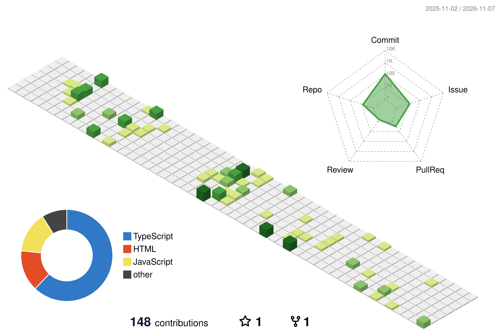
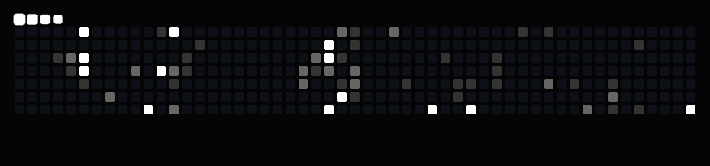

  

  

   

  

    

  <a href="https://github.com/ShadowGaming100">
    
    <strong>GitHub</strong>
  </a>
  &nbsp;&nbsp;&nbsp;&nbsp;
  <a href="https://freehosts.eu">
    
    <strong>FreeHosts</strong>
  </a>
  &nbsp;&nbsp;&nbsp;&nbsp;
  <a href="mailto:shadow@freehosts.eu">
    
    <strong>Contact</strong>
  </a>

---

  

## ⬡ TECHNOLOGIES

  

---

## ◈ WHAT I DO

**01 / FOUNDER**

### FreeHosts

Building FreeHosts, a community-driven directory for discovering free hosting providers.

 

**02 / DEVELOPER**

### Nemethic

Developer at Nemethic.

---

## ◈ FEATURED PROJECT

  

  ### FreeHosts

  A community-driven directory for discovering free hosting providers.

  <a href="https://freehosts.eu">Explore FreeHosts ↗</a>

---

## ◈ GITHUB STATISTICS

  <picture>
    <source media="(prefers-color-scheme: dark)" srcset="./assets/overview.dark.svg" />
    
  </picture>
   
  <picture>
    <source media="(prefers-color-scheme: dark)" srcset="./assets/contributions.dark.svg" />
    
  </picture>
   
  <picture>
    <source media="(prefers-color-scheme: dark)" srcset="./assets/languages.dark.svg" />
    
  </picture>

---

## ◈ 3D CONTRIBUTION WORLD

  

---

## ◈ CONTRIBUTION SNAKE

  

---

## ◈ GITHUB TROPHIES

  

---

## ◈ GITHUB ACTIVITY

  

---

  

  © ShadowGaming100

