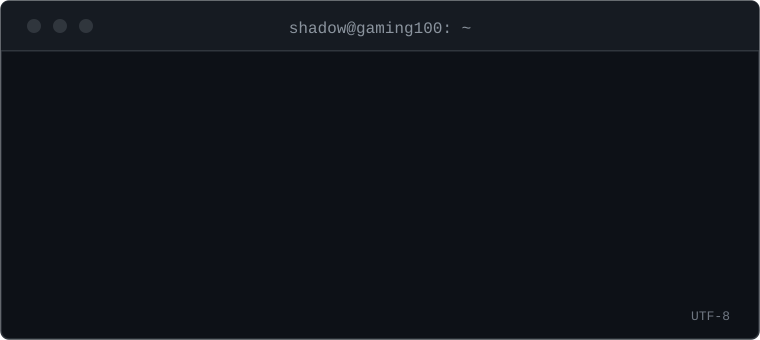
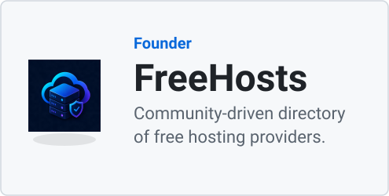
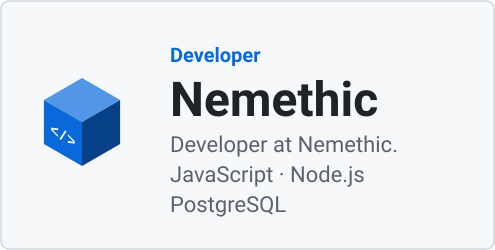
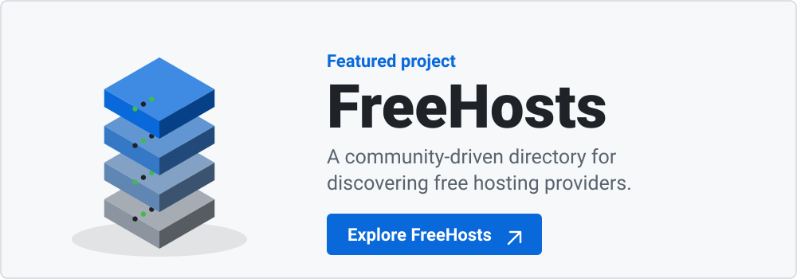
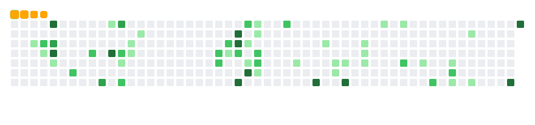

  <picture>
    <source media="(prefers-color-scheme: dark)" srcset="./assets/hero.dark.svg" />
    
  </picture>

  <picture>
    <source media="(prefers-color-scheme: dark)" srcset="./assets/typing.dark.svg" />
    
  </picture>

   

  <a href="https://github.com/ShadowGaming100"><picture><source media="(prefers-color-scheme: dark)" srcset="./assets/buttons/github.dark.svg" /></picture></a>
  <a href="https://freehosts.eu"><picture><source media="(prefers-color-scheme: dark)" srcset="./assets/buttons/freehosts.dark.svg" /></picture></a>
  <a href="mailto:shadow@freehosts.eu"><picture><source media="(prefers-color-scheme: dark)" srcset="./assets/buttons/contact.dark.svg" /></picture></a>

 

  <picture>
    <source media="(max-width: 600px) and (prefers-color-scheme: dark)" srcset="./assets/headers/about.m.dark.svg" />
    <source media="(max-width: 600px) and (prefers-color-scheme: light)" srcset="./assets/headers/about.m.light.svg" />
    <source media="(prefers-color-scheme: dark)" srcset="./assets/headers/about.dark.svg" />
    
  </picture>

I run FreeHosts and write code at Nemethic. Most days that means JavaScript, Node.js and PostgreSQL.

  <picture>
    <source media="(max-width: 600px)" srcset="./assets/terminal.m.svg" />
    
  </picture>

 

  <picture>
    <source media="(max-width: 600px) and (prefers-color-scheme: dark)" srcset="./assets/headers/roles.m.dark.svg" />
    <source media="(max-width: 600px) and (prefers-color-scheme: light)" srcset="./assets/headers/roles.m.light.svg" />
    <source media="(prefers-color-scheme: dark)" srcset="./assets/headers/roles.dark.svg" />
    
  </picture>

  <a href="https://freehosts.eu"><picture><source media="(prefers-color-scheme: dark)" srcset="./assets/role.founder.dark.svg" /></picture></a>
  <picture>
    <source media="(prefers-color-scheme: dark)" srcset="./assets/role.developer.dark.svg" />
    
  </picture>

 

  <picture>
    <source media="(max-width: 600px) and (prefers-color-scheme: dark)" srcset="./assets/headers/stack.m.dark.svg" />
    <source media="(max-width: 600px) and (prefers-color-scheme: light)" srcset="./assets/headers/stack.m.light.svg" />
    <source media="(prefers-color-scheme: dark)" srcset="./assets/headers/stack.dark.svg" />
    
  </picture>

  <picture>
    <source media="(prefers-color-scheme: dark)" srcset="./assets/stack/js.dark.svg" />
    
  </picture>
  <picture>
    <source media="(prefers-color-scheme: dark)" srcset="./assets/stack/node.dark.svg" />
    
  </picture>
  <picture>
    <source media="(prefers-color-scheme: dark)" srcset="./assets/stack/djs.dark.svg" />
    
  </picture>
  <picture>
    <source media="(prefers-color-scheme: dark)" srcset="./assets/stack/express.dark.svg" />
    
  </picture>
  <picture>
    <source media="(prefers-color-scheme: dark)" srcset="./assets/stack/next.dark.svg" />
    
  </picture>
  <picture>
    <source media="(prefers-color-scheme: dark)" srcset="./assets/stack/pg.dark.svg" />
    
  </picture>
  <picture>
    <source media="(prefers-color-scheme: dark)" srcset="./assets/stack/cf.dark.svg" />
    
  </picture>
  
Day to day: JavaScript, Node.js and PostgreSQL.

  <picture>
    <source media="(prefers-color-scheme: dark)" srcset="https://skillicons.dev/icons?i=js,nodejs,discordjs,express,nextjs,postgres,cloudflare&theme=dark&perline=7" />
    
  </picture>

 

  <picture>
    <source media="(max-width: 600px) and (prefers-color-scheme: dark)" srcset="./assets/headers/featured.m.dark.svg" />
    <source media="(max-width: 600px) and (prefers-color-scheme: light)" srcset="./assets/headers/featured.m.light.svg" />
    <source media="(prefers-color-scheme: dark)" srcset="./assets/headers/featured.dark.svg" />
    
  </picture>

  <a href="https://freehosts.eu"><picture><source media="(max-width: 600px) and (prefers-color-scheme: dark)" srcset="./assets/featured.m.dark.svg" /><source media="(max-width: 600px) and (prefers-color-scheme: light)" srcset="./assets/featured.m.light.svg" /><source media="(prefers-color-scheme: dark)" srcset="./assets/featured.dark.svg" /></picture></a>

 

  <picture>
    <source media="(max-width: 600px) and (prefers-color-scheme: dark)" srcset="./assets/headers/stats.m.dark.svg" />
    <source media="(max-width: 600px) and (prefers-color-scheme: light)" srcset="./assets/headers/stats.m.light.svg" />
    <source media="(prefers-color-scheme: dark)" srcset="./assets/headers/stats.dark.svg" />
    
  </picture>

  <picture>
    <source media="(prefers-color-scheme: dark)" srcset="./assets/overview.dark.svg" />
    
  </picture>
   
  <picture>
    <source media="(prefers-color-scheme: dark)" srcset="./assets/contributions.dark.svg" />
    
  </picture>
   
  <picture>
    <source media="(prefers-color-scheme: dark)" srcset="./assets/languages.dark.svg" />
    
  </picture>

 

  <picture>
    <source media="(max-width: 600px) and (prefers-color-scheme: dark)" srcset="./assets/headers/world.m.dark.svg" />
    <source media="(max-width: 600px) and (prefers-color-scheme: light)" srcset="./assets/headers/world.m.light.svg" />
    <source media="(prefers-color-scheme: dark)" srcset="./assets/headers/world.dark.svg" />
    
  </picture>

  <picture>
    <source media="(prefers-color-scheme: dark)" srcset="./profile-3d-contrib/profile-night-green.svg" />
    
  </picture>

 

  <picture>
    <source media="(max-width: 600px) and (prefers-color-scheme: dark)" srcset="./assets/headers/snake.m.dark.svg" />
    <source media="(max-width: 600px) and (prefers-color-scheme: light)" srcset="./assets/headers/snake.m.light.svg" />
    <source media="(prefers-color-scheme: dark)" srcset="./assets/headers/snake.dark.svg" />
    
  </picture>

  <picture>
    <source media="(prefers-color-scheme: dark)" srcset="./assets/snake.dark.gif" />
    
  </picture>

 

  <picture>
    <source media="(max-width: 600px) and (prefers-color-scheme: dark)" srcset="./assets/headers/trophies.m.dark.svg" />
    <source media="(max-width: 600px) and (prefers-color-scheme: light)" srcset="./assets/headers/trophies.m.light.svg" />
    <source media="(prefers-color-scheme: dark)" srcset="./assets/headers/trophies.dark.svg" />
    
  </picture>

  <picture>
    <source media="(prefers-color-scheme: dark)" srcset="./assets/trophy.dark.svg" />
    
  </picture>

 

  <picture>
    <source media="(prefers-color-scheme: dark)" srcset="./assets/footer.dark.svg" />
    
  </picture>

