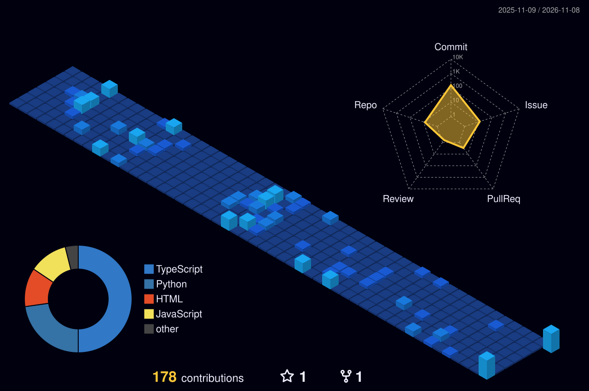

 

 

⸻

⬡ TECHNOLOGIES

⸻

◈ WHAT I DO

FreeHosts

Building and growing a community-driven free hosting directory.

Nemethic

Software development at Nemethic.

⸻

◈ FEATURED PROJECT

 

FreeHosts

Discover free hosting for the things you build.

A community-driven directory for discovering free hosting providers.

⸻

◈ GITHUB ANALYTICS

 

 

⸻

◈ 3D CONTRIBUTION WORLD

⸻

◈ CONTRIBUTION SNAKE

<picture>
  <source media="(prefers-color-scheme: dark)" srcset="./assets/github-snake-dark.svg" />
  <source media="(prefers-color-scheme: light)" srcset="./assets/github-snake.svg" />
  
</picture>

⸻

◈ GITHUB TROPHIES

⸻

◈ ACTIVITY GRAPH

⸻

© ShadowGaming100

