

  <picture>
    <source media="(prefers-color-scheme: dark)" srcset="https://raw.githubusercontent.com/ShadowGaming100/ShadowGaming100/master/assets/hero.dark.gif" />
    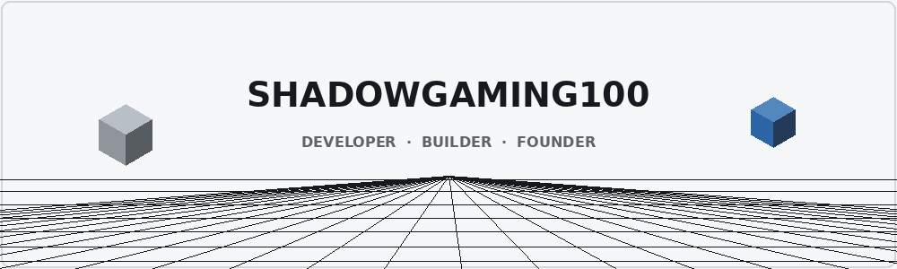
  </picture>

  <a href="https://github.com/ShadowGaming100"><picture><source media="(prefers-color-scheme: dark)" srcset="./assets/buttons/github.dark.svg" /></picture></a>
  <a href="https://freehosts.eu"><picture><source media="(prefers-color-scheme: dark)" srcset="./assets/buttons/freehosts.dark.svg" /></picture></a>
  <a href="mailto:shadow@freehosts.eu"><picture><source media="(prefers-color-scheme: dark)" srcset="./assets/buttons/contact.dark.svg" /></picture></a>

 

  <picture>
    <source media="(max-width: 600px) and (prefers-color-scheme: dark)" srcset="./assets/headers/about.m.dark.svg" />
    <source media="(max-width: 600px) and (prefers-color-scheme: light)" srcset="./assets/headers/about.m.light.svg" />
    <source media="(prefers-color-scheme: dark)" srcset="./assets/headers/about.dark.svg" />
    
  </picture>

I’m a founder and developer interested in building useful projects and exploring new technologies.

I work across frontend and backend development, APIs, Discord bots, and self-hosted infrastructure.

Currently building FreeHosts v2.

Always excited to learn new things.

  <picture>
    <source media="(prefers-color-scheme: dark)" srcset="https://raw.githubusercontent.com/ShadowGaming100/ShadowGaming100/master/assets/typing.dark.gif" />
    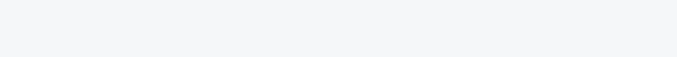
  </picture>

  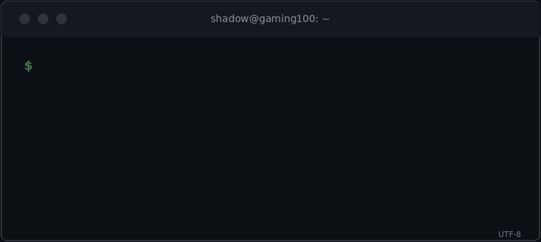

 

  <picture>
    <source media="(max-width: 600px) and (prefers-color-scheme: dark)" srcset="./assets/headers/stack.m.dark.svg" />
    <source media="(max-width: 600px) and (prefers-color-scheme: light)" srcset="./assets/headers/stack.m.light.svg" />
    <source media="(prefers-color-scheme: dark)" srcset="./assets/headers/stack.dark.svg" />
    
  </picture>

  
<strong>Languages</strong>

  <picture><source media="(prefers-color-scheme: dark)" srcset="./assets/stack/js.dark.svg" /></picture>
  <picture><source media="(prefers-color-scheme: dark)" srcset="./assets/stack/ts.dark.svg" /></picture>
  <picture><source media="(prefers-color-scheme: dark)" srcset="./assets/stack/py.dark.svg" />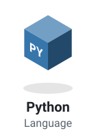</picture>
  <picture><source media="(prefers-color-scheme: dark)" srcset="./assets/stack/html.dark.svg" /></picture>
  <picture><source media="(prefers-color-scheme: dark)" srcset="./assets/stack/css.dark.svg" /></picture>

  
<strong>Runtime &amp; Frameworks</strong>

  <picture><source media="(prefers-color-scheme: dark)" srcset="./assets/stack/node.dark.svg" /></picture>
  <picture><source media="(prefers-color-scheme: dark)" srcset="./assets/stack/djs.dark.svg" />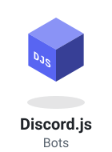</picture>
  <picture><source media="(prefers-color-scheme: dark)" srcset="./assets/stack/express.dark.svg" />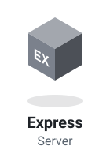</picture>
  <picture><source media="(prefers-color-scheme: dark)" srcset="./assets/stack/next.dark.svg" /></picture>
  <picture><source media="(prefers-color-scheme: dark)" srcset="./assets/stack/fastify.dark.svg" />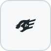</picture>

  
<strong>Databases</strong>

  <picture><source media="(prefers-color-scheme: dark)" srcset="./assets/stack/pg.dark.svg" />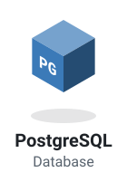</picture>
  <picture><source media="(prefers-color-scheme: dark)" srcset="./assets/stack/mysql.dark.svg" /></picture>
  <picture><source media="(prefers-color-scheme: dark)" srcset="./assets/stack/mongo.dark.svg" /></picture>

  
<strong>Infrastructure</strong>

  <picture><source media="(prefers-color-scheme: dark)" srcset="./assets/stack/cf.dark.svg" /></picture>

  
<strong>Tools</strong>

  <picture><source media="(prefers-color-scheme: dark)" srcset="./assets/stack/git.dark.svg" />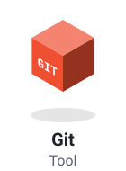</picture>
  <picture><source media="(prefers-color-scheme: dark)" srcset="./assets/stack/github.dark.svg" /></picture>
  <picture><source media="(prefers-color-scheme: dark)" srcset="./assets/stack/gha.dark.svg" /></picture>

 

  <picture>
    <source media="(max-width: 600px) and (prefers-color-scheme: dark)" srcset="./assets/headers/featured.m.dark.svg" />
    <source media="(max-width: 600px) and (prefers-color-scheme: light)" srcset="./assets/headers/featured.m.light.svg" />
    <source media="(prefers-color-scheme: dark)" srcset="./assets/headers/featured.dark.svg" />
    
  </picture>

  <a href="https://freehosts.eu">
    <picture>
      <source media="(prefers-color-scheme: dark)" srcset="https://raw.githubusercontent.com/ShadowGaming100/ShadowGaming100/master/assets/featured.dark.gif" />
      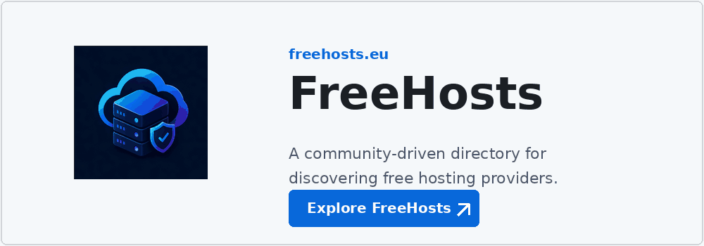
    </picture>
  </a>

 

  <picture>
    <source media="(max-width: 600px) and (prefers-color-scheme: dark)" srcset="./assets/headers/stats.m.dark.svg" />
    <source media="(max-width: 600px) and (prefers-color-scheme: light)" srcset="./assets/headers/stats.m.light.svg" />
    <source media="(prefers-color-scheme: dark)" srcset="./assets/headers/stats.dark.svg" />
    
  </picture>

  <picture>
    <source media="(prefers-color-scheme: dark)" srcset="./assets/overview.dark.svg" />
    
  </picture>
   
  <picture>
    <source media="(prefers-color-scheme: dark)" srcset="./assets/contributions.dark.svg" />
    
  </picture>
   
  <picture>
    <source media="(prefers-color-scheme: dark)" srcset="./assets/languages.dark.svg" />
    
  </picture>

 

  <picture>
    <source media="(max-width: 600px) and (prefers-color-scheme: dark)" srcset="./assets/headers/world.m.dark.svg" />
    <source media="(max-width: 600px) and (prefers-color-scheme: light)" srcset="./assets/headers/world.m.light.svg" />
    <source media="(prefers-color-scheme: dark)" srcset="./assets/headers/world.dark.svg" />
    
  </picture>

  <!-- CONTRIBUTION-YEARS:START -->

  ### 2026 — January 1 to December 31, 2026

  <picture>
    <source media="(prefers-color-scheme: dark)" srcset="./profile-3d-contrib/profile-night-2026.svg" />
    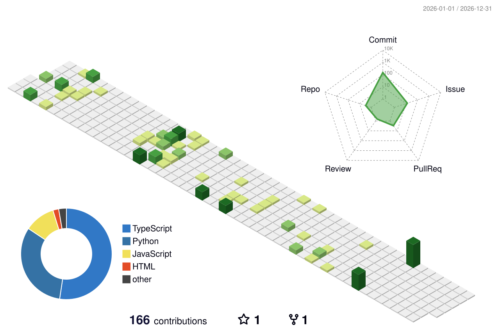
  </picture>

  ### 2025 — January 1 to December 31, 2025

  <picture>
    <source media="(prefers-color-scheme: dark)" srcset="./profile-3d-contrib/profile-night-2025.svg" />
    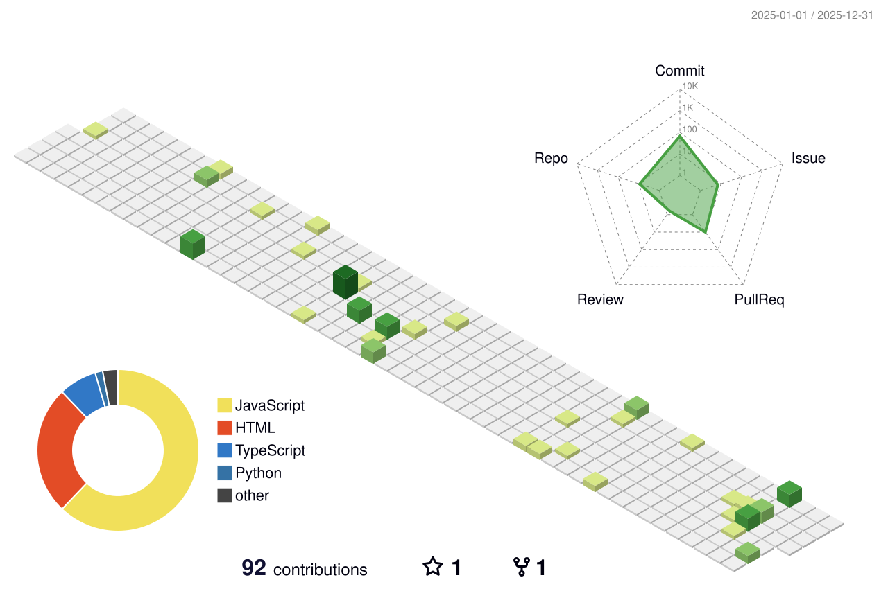
  </picture>

  ### All years — January 1, 2021 to December 31, 2026

  <picture>
    <source media="(prefers-color-scheme: dark)" srcset="./profile-3d-contrib/profile-night-all-years.svg" />
    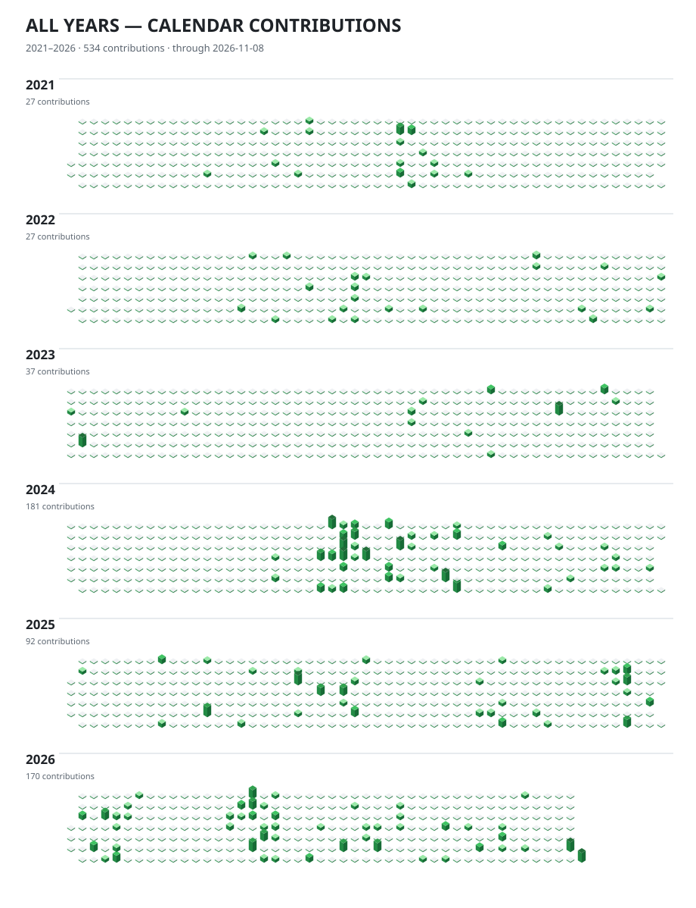
  </picture>

  **All Time — Complete Available Contribution History**

  <picture>
    <source media="(prefers-color-scheme: dark)" srcset="./profile-3d-contrib/profile-night-all-time.svg" />
    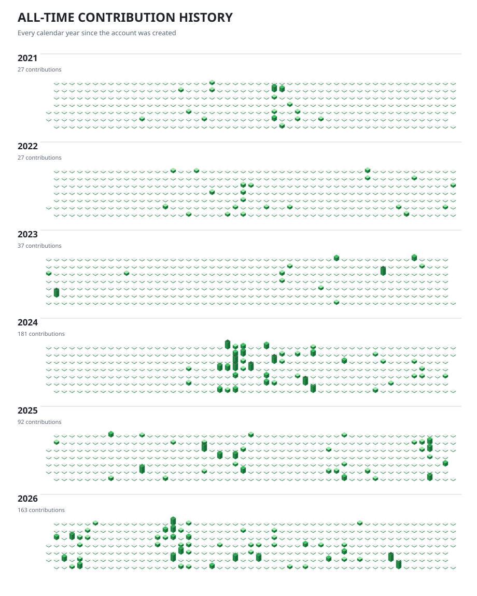
  </picture>

<!-- CONTRIBUTION-YEARS:END -->

 

  <picture>
    <source media="(max-width: 600px) and (prefers-color-scheme: dark)" srcset="./assets/headers/snake.m.dark.svg" />
    <source media="(max-width: 600px) and (prefers-color-scheme: light)" srcset="./assets/headers/snake.m.light.svg" />
    <source media="(prefers-color-scheme: dark)" srcset="./assets/headers/snake.dark.svg" />
    
  </picture>

  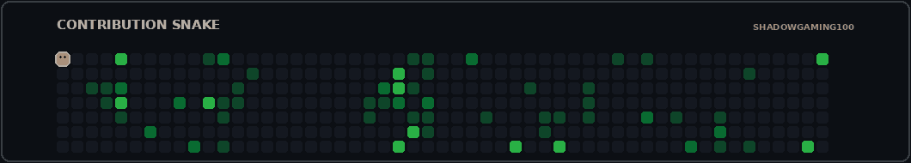

 

  <picture>
    <source media="(max-width: 600px) and (prefers-color-scheme: dark)" srcset="./assets/headers/trophies.m.dark.svg" />
    <source media="(max-width: 600px) and (prefers-color-scheme: light)" srcset="./assets/headers/trophies.m.light.svg" />
    <source media="(prefers-color-scheme: dark)" srcset="./assets/headers/trophies.dark.svg" />
    
  </picture>

  <picture>
    <source media="(prefers-color-scheme: dark)" srcset="./assets/trophy.dark.svg" />
    
  </picture>

 

  <picture>
    <source media="(prefers-color-scheme: dark)" srcset="./assets/footer.dark.svg" />
    
  </picture>

